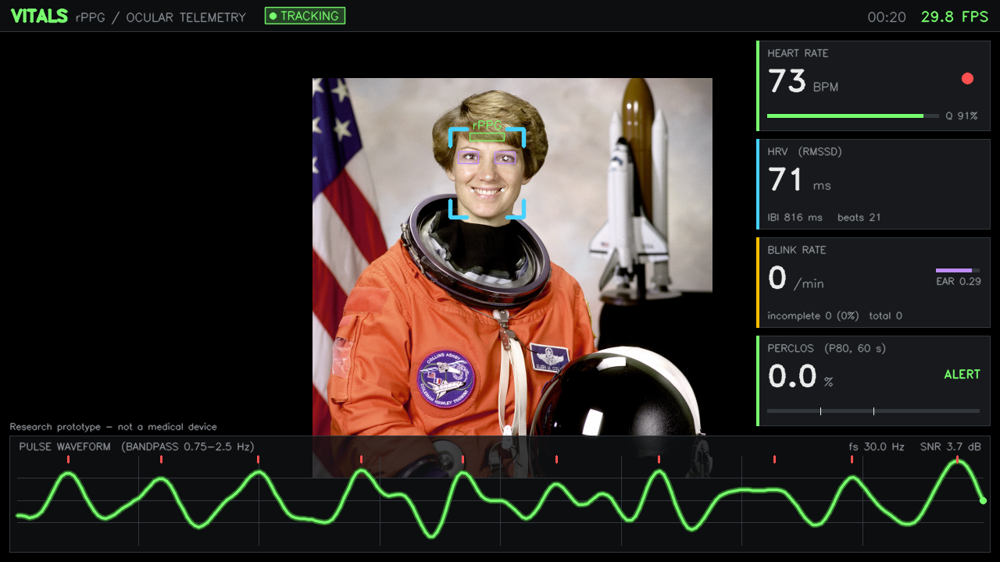

# Vitals Monitor — rPPG Heart Rate & Ocular Fatigue (C++17 / OpenCV)

تطبيق C++17 معياري لقياس **معدل نبض القلب بدون تلامس (rPPG)** و**تقلب نبض القلب (HRV)** ومراقبة **إجهاد العين** (معدل الرمش، الرمشات غير المكتملة، PERCLOS) في الزمن الحقيقي من كاميرا ويب عادية.



> ⚠️ نموذج بحثي — **ليس جهازًا طبيًا** ولا يصلح للتشخيص.

---

## البنية

```
├── CMakeLists.txt            # CMake 3.16+، ‎-O3، تنزيل نموذج YuNet تلقائيًا
├── cmake/FetchModel.cmake    # هدف `fetch_model` لإعادة التنزيل يدويًا
├── include/
│   ├── FaceTracker.hpp       # YuNet + 5 معالم + مناطق ROI مستقرة (EMA): الجبهة، العينان، الخدّان
│   ├── SignalProcessor.hpp   # خط DSP لإشارة rPPG ‏(cv::dft)
│   ├── OcularAnalyzer.hpp    # EAR تقديري، الرمش، PERCLOS
│   └── TelemetryUI.hpp       # واجهة HUD طبية داكنة
├── src/                      # التنفيذ + main.cpp (دورة حياة التطبيق)
└── tests/test_pipeline.cpp   # اختبارات انحدار على إشارات اصطناعية (بلا كاميرا)
```

| الوحدة | المسؤولية |
|---|---|
| **FaceTracker** | `cv::FaceDetectorYN` على صورة مصغّرة (عرض 320 بكسل، مع حشو لمضاعفات 32). يختار الوجه المهيمن (المساحة × الثقة + استمرارية IoU). يحسب منطقة الجبهة بين الحاجبين (‎0.42×IOD) وخط الشعر المقاس **ديناميكيًا** من لونية الجلد (YCrCb) بالمسح صعودًا، ومنطقتي العينين، ومنطقتي الخدّين (0.62×IOD تحت كل عين). EMA على الصناديق والمعالم مع «قفز» عند الحركات الكبيرة، وتجاوز مؤقت لعدد قليل من الإطارات المفقودة. |
| **SignalProcessor** | متوسط RGB للجلد (قناع YCrCb) من **الجبهة والخدّين** ← مخزن دائري (256–512 عينة مع طوابع زمنية) ← إعادة أخذ عينات منتظمة بمعدل **مقاس فعليًا** في كل نافذة (يظهر `fs` في الواجهة) ← **POS** ‏(Wang et al. 2017): تطبيع زمني لكل قناة في نافذة 1.6 ث، إسقاط على المستوى العمودي على لون الجلد `S1=G−B`، `S2=G+B−2R`، `h=S1+α·S2`، وجمع متداخل، فيلغي تغيّرات الإضاءة والتعرّض التلقائي المشتركة بين القنوات ← إزالة اتجاه ← Butterworth ‏0.75–2.5 Hz ‏(`filtfilt`) ← Hamming + `cv::dft` ← **المرشّح قيمة عظمى محلية حقيقية في الطيف الكامل فقط** (لا تُقبل حافة النطاق إطلاقًا) مع ترجيح نحو القراءة السابقة، وإعادة التقاط إن خالفته أقوى قمة لمدة 3 ث ← BPM ← IBI ← RMSSD. **الثقة** = `clamp((قدرة فص القمة ÷ قدرة النطاق) × (1/0.8), 0, 1)`. الوضع القديم (الأخضر فقط) متاح بـ `--method=green` للمقارنة. |
| **التنفس (BrPM)** | مخزن منفصل أطول (1024 عينة ≈ 34 ث) للإشارة الخضراء **غير المزالة الاتجاه** (المزيل القصير سيحذف التنفس). تطبيع ← إزالة الاتجاه الخطي ← Butterworth ‏0.15–0.40 Hz (9–24 نفسًا/د) ← Hamming + `cv::dft` (حشو 8192). لا تُعرض القراءة إلا إذا: (1) مرّت 15 ث من البيانات، (2) برزت القمة ≥10 dB فوق أرضية الطيف 0.45–0.70 Hz، (3) وافقها عدّ عبور الصفر (±3 BrPM)، (4) ثبتت آخر 5 ث (±1.5)، (5) ثقتها ≥55%. وإلا تظهر `--`. |
| **OcularAnalyzer** | EAR تقديري = الامتداد العمودي للمنطقة الداكنة (قزحية/رموش، بعتبة نسبية لوسيط الرقعة فلا يتأثر بالإضاءة) ÷ عرض العين؛ مفتوحة ≈ 0.30. العتبة تكيفية: **0.75 × المتوسط المتحرك لـ EAR (10 ث، إطارات العين المفتوحة فقط)**. رمشة = هبوط تحت العتبة لمدة **2–8 إطارات** (تتناسب مع FPS)، وإغلاق أطول = «إغلاق طويل». رمشة غير مكتملة إن لم ينزل EAR دون 0.45 × المتوسط. PERCLOS = نسبة الإطارات التي EAR فيها < 0.35 × المتوسط خلال آخر 60 ث. |
| **TelemetryUI** | شريط علوي (الحالة، الساعة، FPS)، خمس بطاقات (BPM + ثقة، HRV، **معدل التنفس**، معدل الرمش + EAR مع خط العتبة، PERCLOS بنطاقات تنبيه)، موجة نبض متحركة مع علامات النبضات، ومستطيلات شفافة على الجبهة والعينين. كل النسب المئوية مقصوصة في [0, 100]. |

### السلامة ودورة الحياة
- **فقد الوجه** ⇐ تجميد المخازن (`pause`). عند العودة خلال أقل من ثانيتين يُوصل الخط الزمني ويُعاد ضبط مستوى DC؛ إن طال الانقطاع أكثر يُفرّغ المخزن لأن الطور لم يعد متسقًا.
- **حركة رأس كبيرة** (أكثر من 0.08×IOD لكل إطار) ⇐ إيقاف مؤقت لأخذ العينات حتى لا تتلوث FFT.
- **انقطاع الكاميرا** ⇐ شاشة «CAMERA DISCONNECTED» ومحاولات إعادة اتصال بتراجع أُسّي (0.5 ← 8 ث).
- الخروج النظيف بـ `ESC` أو `q` أو إغلاق النافذة أو `Ctrl+C`. ويعيد `r` ضبط القياسات.

---

## المتطلبات

- مترجم C++17 ‏(GCC 9+‎ / Clang 10+‎ / MSVC 2019+‎)
- CMake ‏3.16+‎
- OpenCV ‏4.5.4+‎ مع الوحدات: `core imgproc videoio highgui dnn objdetect`
  (`cv::FaceDetectorYN` موجودة في `objdetect`، التي تعتمد على `dnn`)
- **يوصى بـ OpenCV ‏4.8+‎**، فنموذج `face_detection_yunet_2023mar.onnx` يتطلبها.
  مع OpenCV ‏4.5.4–4.7 يختار CMake تلقائيًا `face_detection_yunet_2022mar.onnx`، لكن هذا النموذج لم يعد موجودًا في الفرع الرئيسي لـ opencv_zoo، فيجب وضعه يدويًا في `models/`.

```bash
# Ubuntu 24.04 (OpenCV 4.6) — للاختبار؛ يفضل بناء 4.8+ أو استخدام vcpkg/conda
sudo apt install build-essential cmake libopencv-dev
```

## البناء

```bash
cmake -S . -B build -DCMAKE_BUILD_TYPE=Release
```

```bash
cmake --build build -j
```

يُنزّل CMake نموذج YuNet تلقائيًا إلى `models/` إن لم يكن موجودًا (`-DVITALS_DOWNLOAD_MODEL=ON` افتراضيًا). للتنزيل اليدوي:

```bash
curl -L -o models/face_detection_yunet_2023mar.onnx https://media.githubusercontent.com/media/opencv/opencv_zoo/main/models/face_detection_yunet/face_detection_yunet_2023mar.onnx
```

خيارات إضافية: `-DVITALS_NATIVE_ARCH=ON` ‏(‎-march=native)، و`-DVITALS_WARNINGS_AS_ERRORS=ON`، و`-DVITALS_BUILD_TESTS=OFF`.

## التشغيل

```bash
./build/vitals_monitor
```

```bash
./build/vitals_monitor --camera=1 --width=1280 --height=720 --buffer=512
```

```bash
./build/vitals_monitor --video=recording.mp4 --headless=true --log=2
```

| الوسيط | الافتراضي | الوصف |
|---|---|---|
| `--camera` | `0` | رقم الكاميرا |
| `--video` | — | ملف فيديو بدلًا من الكاميرا (يستخدم ساعة الوسائط) |
| `--model` | `models/…onnx` | مسار نموذج YuNet |
| `--width` / `--height` / `--fps` | `1280` / `720` / `30` | دقة الالتقاط المطلوبة |
| `--buffer` | `512` | طول مخزن rPPG ‏(256–512) |
| `--mirror` | `true` | عرض مرآوي |
| `--headless` | `false` | بلا نافذة (للخوادم أو المعالجة دون اتصال) |
| `--log` | `0` | طباعة القياسات كل N ثانية |
| `--max-motion` | `0.08` | عتبة الحركة لإيقاف أخذ العينات |
| `--method` | `pos` | استخراج النبض: `pos` (مقاوم للإضاءة) أو `green` (للمقارنة) |
| `--save` | — | حفظ المعاينة مع اللوحة في ملف فيديو، مثل `preview.mp4` |

**المفاتيح:** ‏`ESC`/`q` للخروج، و`r` لإعادة ضبط المخازن.

## الاختبارات

```bash
ctest --test-dir build --output-on-failure
```

تولّد الاختبارات إشارات rPPG اصطناعية (52/72/95/130 BPM، معدلات 25–30 FPS مع تذبذب، انجراف وضوضاء، HRV حقيقي) وصور عيون اصطناعية برمشات كاملة وجزئية وإغلاق طويل، وتتحقق من: دقة BPM (أقل من ±3)، وIBI، وRMSSD، **وبقاء الثقة في [0,1] وتناقصها مع الضوضاء**، **ومعدل التنفس (10/15/22 BrPM) ورفض الضوضاء البحتة**، والإيقاف المؤقت/الاستئناف، وعدد الرمشات عند 15/30/60 FPS مع انجراف إضاءة وحركة نظر، وPERCLOS في سيناريو النعاس.

## نصائح للحصول على قراءة جيدة
- إضاءة ثابتة ومنتشرة (تجنّب الإضاءة المتذبذبة 50/60 Hz والشاشات الوامضة).
- ثبّت الرأس واترك الجبهة مكشوفة (الغُرّة تقلّص منطقة القياس).
- الإضاءة الخافتة تخفض FPS الكاميرا (مثلًا 20 بدل 30). القياس يتكيف مع ذلك تلقائيًا، لكن الضوء الجيد يعطي إشارة أقوى.
- انتظر نحو 5 ثوانٍ قبل ظهور أول تقدير، ونحو 15 ثانية حتى يمتلئ المخزن.
- قيمة HRV المقاسة بكاميرا 30 FPS تقريبية (دقة زمنية نحو 33 مللي ث تُحسَّن باستيفاء القمم).
- مؤشر EAR هنا **تقديري من مظهر العين** (لا تتوفر نقاط الجفن مع معالم YuNet الخمسة)، ويحتاج 3 ثوانٍ للمعايرة.
